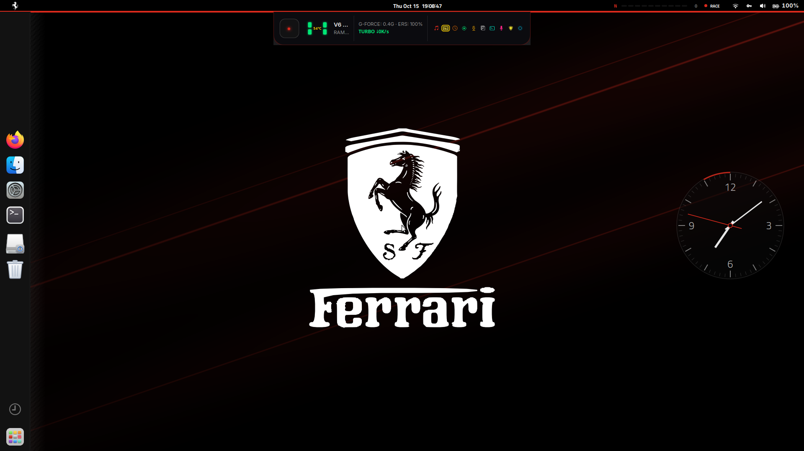
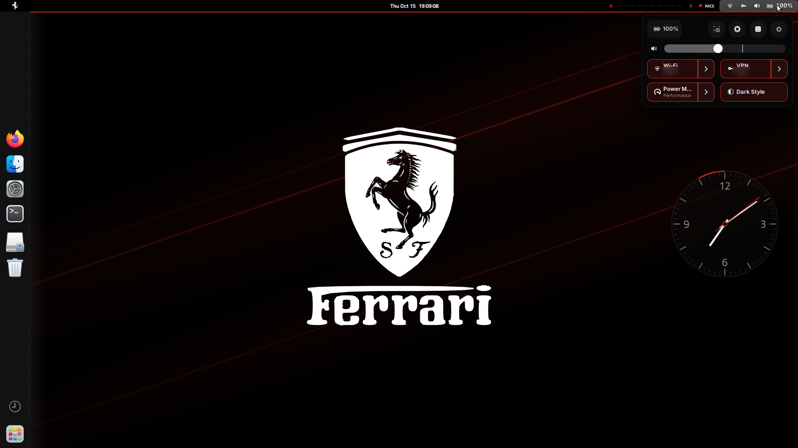
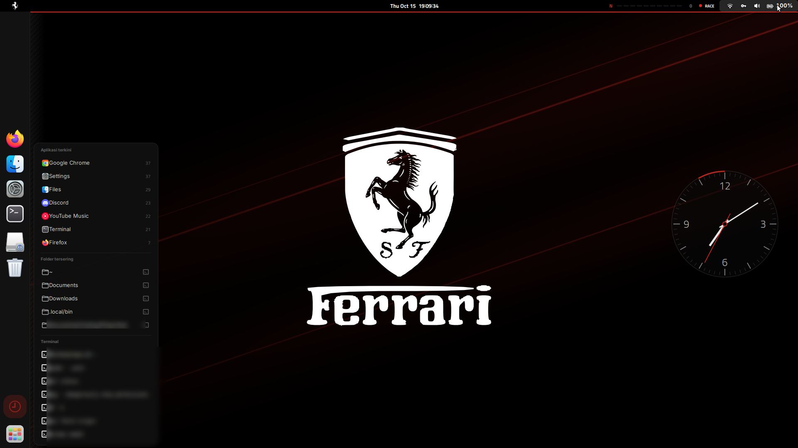

# ferrari-ubuntu

Racikan UI Ubuntu 24.04 (GNOME 46) bergaya macOS-minimalis dengan signatur
Ferrari: panel gelap ramping, dock full-height di kiri, aksen Rosso Corsa,
tipografi Titillium/Inter, cluster rev-light di panel atas, team radio saat
baterai berubah, jam ambient noir, start-light gantry saat login, plus tema
layar login (GDM) dan splash Plymouth.

Repo ini berisi **kode dan aset buatan sendiri** serta langkah memasang
dependensi pihak ketiga. Bukan fork besar tema ikon/GTK.

## Tampilan



| Quick Settings: kartu berbingkai rosso, baterai dan mode daya | Rail sub-panel di sisi dock (`Super+R`) |
|---|---|
|  |  |

Ketiga gambar dirender pada 1920x1080 dari rig Xephyr (:9) dengan salinan dconf
tersendiri, jadi sesi kerja tidak ikut tersentuh. Nama jaringan Wi-Fi/VPN dan
isi riwayat pada rail disensor — datanya berasal dari mesin pengembang. Layar
ambient `noir-clock` belum ditampilkan karena idle monitor X11 di dalam
Xephyr melapor hitung-mundur, sehingga veil tidak pernah naik di rig.

```
ferrari-ubuntu/
├── README.md                  dokumen ini
├── LICENSE  NOTICE            lisensi karya sendiri + kredit pihak ketiga
├── extensions/                noir-cluster, noir-rail, noir-clock, noir-startlights,
│                              noir-telemetry, noir-island
├── assets/
│   ├── wallpapers/            hasil render sendiri + XML dinamis 3 fasa
│   ├── sounds/                panggilan radio (.oga) + gen-radio.py
│   ├── plymouth/noir-rosso/   splash boot noir
│   └── gdm/                   gresource tema layar login + CSS tambahan
├── theme/overrides/           gnome-shell.css WhiteSur yang sudah ditambahi rosso
├── settings/                  noir.dconf + terminal-profile.dconf
├── scripts/                   install, apply-settings, fetch-deps, install-system,
│                              revert, sanitize-check, refresh-settings
└── docs/                      design-notes, troubleshooting, publication-checklist,
                               gambar/ (screenshot 1920x1080 dari rig)
```

## Prasyarat

| Item | Versi yang dipakai | Catatan |
|---|---|---|
| Ubuntu | 24.04 LTS | rilis lain belum diuji |
| GNOME Shell | 46.2 | 47+ perlu audit API extension, jangan langsung pasang |
| Sesi | **Ubuntu on Wayland** | noir-clock/x11gestures punya jejak di X11; lihat troubleshooting |
| Resolusi | 1920x1080 | skala 1; dock dan panel diatur untuk ukuran ini |

Perlu juga: `git`, `python3`, `ffmpeg` (untuk membuat ulang suara), `dconf-cli`,
`libglib2.0-bin` (`glib-compile-schemas`).

## Pemasangan

Klon dulu ke mesin target:

```bash
git clone https://github.com/ArkanFzi/ferrari-ubuntu.git
cd ferrari-ubuntu
```

### 0. Periksa dependensi pihak ketiga

```bash
bash scripts/fetch-deps.sh --check
```

Skrip mencetak apa yang belum ada dan dari mana mengambilnya (WhiteSur GTK,
Mkos-Big-Sur icons, DMZ cursors, font Inter/Titillium/Hack, extension GNOME).
Jalankan tanpa `--check` untuk mengkloning WhiteSur ke `.deps/` dan melihat
perintah lanjutannya.

### 1. Keringkan dulu (tidak menulis apa pun)

```bash
bash scripts/install.sh --dry-run
```

### 2. Pasang level user

```bash
bash scripts/install.sh
```

Yang dilakukan: backup ke `~/.local/share/ferrari-ubuntu-backup/<stempel>` →
pasang 4 extension noir (+ compile schema lokal) → salin wallpaper dan render
XML dinamis ke `$HOME` → salin berkas suara ke `~/.local/share/sounds/Yaru/stereo/`
→ tambahi `gnome-shell.css` WhiteSur dengan aksen rosso → terapkan
`settings/noir.dconf` dan palet terminal.

### 3. Logout lalu login

Wayland tidak bisa `Alt+F2 r`. JS extension dibaca sekali per proses shell, jadi
tanpa login ulang banyak bagian tidak muncul.

### 4. Bagian sistem (butuh sudo, opsional)

```bash
bash scripts/install-system.sh --print   # lihat perintahnya dulu
bash scripts/install-system.sh           # jalankan, konfirmasi per langkah
```

Memasang gresource tema GDM (pita tricolore + layar login noir) dan splash
Plymouth `noir-rosso`. Langkah `plymouth-set-default-theme -R` membangun ulang
initramfs — karena itu script ini selalu bertanya, tidak pernah auto-sudo.

### 5. Verifikasi

```bash
gnome-extensions list --enabled | grep noir          # 5 extension muncul
gsettings get org.gnome.desktop.interface font-name  # 'Inter 10'
gsettings get org.gnome.desktop.interface gtk-theme  # 'WhiteSur-Dark-orange'
plymouth-set-default-theme                           # noir-rosso (jika langkah 4 dijalankan)
bash scripts/install.sh --check                      # semua "ada"
bash scripts/apply-settings.sh --check               # "semua setelan sudah cocok"
gnome-session-inhibit -l                             # entri suspend/idle menyalakan chip PIT
```

Angka telemetri di menu chip harus sama dengan sensor aslinya (lm-sensors tidak
dibutuhkan, semuanya sysfs):

```bash
C=$(grep -l '^coretemp$' /sys/class/hwmon/*/name | cut -d/ -f5)
H=$(grep -l '^hp$'       /sys/class/hwmon/*/name | cut -d/ -f5)
awk '{printf "CPU %d C\n", $1/1000}' /sys/class/hwmon/$C/temp1_input
cat /sys/class/hwmon/$H/fan1_input /sys/class/hwmon/$H/fan2_input   # rpm kipas
nvidia-smi --query-gpu=temperature.gpu --format=csv,noheader        # suhu GPU
powerprofilesctl get                            # profil yang sedang berlaku
journalctl /usr/bin/gnome-shell -b | grep "noir-cluster: auto"      # langkah termostat
```

Uji suara radio tanpa mencabut kabel:

```bash
canberra-gtk-play -i radio-box -d noir-cluster      # "BOX, BOX" baterai 20%
canberra-gtk-play -i radio-plug -d noir-cluster     # kabel masuk
canberra-gtk-play -i radio-unplug -d noir-cluster   # kabel lepas
wpctl status | grep -A2 canberra                    # stream [active]
```

## Hasil akhir per area

- **Panel**: tinggi 26 px, ikon tersembunyi rapi, cluster F1 di kanan (gear +
  10 LED rev + kecepatan) yang hanya muncul saat mesin sibuk; mode WET/SPORT/
  RACE/AUTO-nya memilih profil daya, dan menu chip memuat baris telemetri
  `CPU … GPU … FAN …/… rpm` yang dibaca dari hwmon + nvidia-smi yang asli.
  Papan pit-lane menampilkan waktu buka aplikasi di slot yang sama. Chip `PIT`
  (noir-telemetry) menyala di kanan selama ada pemutar media berstatus Playing
  atau ada pihak lain menahan suspend/idle sesi — persis kondisi yang membuat
  layar ambient noir-clock tidak boleh naik.
- **Dock**: kiri, full-height, fixed, ikon 48 px, indikator `DASHES`, dasar
  `#121212` dengan blur; mount + trash tampil sebagai seksi pemisah.
- **Island** (noir-island): pill kecil click-through di tengah bawah panel;
  melebar jadi kartu now-playing (artwork, judul/artis/album, progres, prev /
  play-pause / next) begitu ada `org.mpris.MediaPlayer2.*` berstatus Playing,
  dan didahulukan kartu notifikasi (ikon sumber, body, badge `+N`, tombol
  Tutup/Buka yang bisa diklik). Prioritas NOTIF > MEDIA > IDLE; tidak naik
  selama jendela fullscreen, kecuali urgensi critical.
- **Tipografi**: Inter 10 untuk UI, Titillium Web untuk angka (cluster, jam),
  Hack untuk monospace; weekday + detik di jam panel; persen baterai tampil.
- **Jendela**: layout tombol `close,minimize,maximize:` macOS, Super+Tab untuk
  aplikasi, Alt+Tab untuk jendela, workspaces dinamis, window baru di tengah.
- **Warna**: aksen Rosso Corsa `#da291c` di kursor terminal, highlight, hint
  tiling, indikator baterai, dan garis tema shell.
- **Sesi malam**: night light 17:30 → 06:00 pada 3500 K, idle suspend dimatikan
  (`idle-delay 0`) dan noir-clock memegang inhibitor agar pemutaran video tidak
  membuat laptop tertidur. Jam ambient ikut `idle-delay`: selama 0, layar tidak
  pernah berubah jadi jam besar.
- **Audio event**: panggilan radio saat kabel masuk/lepas, baterai 20 %, dan
  pengisian penuh; suara sistem `power-plug`/`power-unplug`/`battery-low`
  diganti versi noir di folder sound user.
- **Login & boot**: gantry start-light lima lampu saat masuk, layar login dan
  splash Plymouth bernuansa noir.

## Kustomisasi

| Ingin ubah | Cara |
|---|---|
| Warna aksen | cari `#da291c` di `theme/overrides/`, `assets/gdm/*.css`, `settings/*.dconf`; ganti, lalu pasang ulang |
| Mode cluster (WET/SPORT/RACE/AUTO) | `Shift+Super+M`, atau menu di chip panel |
| Ambang termostat AUTO | `extensions/noir-cluster@arkan/extension.js`: `AUTO_UP_*` / `AUTO_DOWN_*` (naik 15 dtk, turun 90 dtk) |
| Matikan AUTO | pilih mode lain di menu chip — kunci `auto-cooling` ikut mati |
| Matikan rev-light | menu chip → "Rev-light" (kunci `rev-lights`) |
| Matikan team radio | menu chip → "Team radio" (kunci `team-radio`), atau `org.gnome.desktop.sound event-sounds` |
| Buat suara radio baru | edit `assets/sounds/gen-radio.py` (bisa `RADIO_OUT=/tmp/x python3 gen-radio.py radio-plug` untuk uji), lalu salin `.oga` hasil render |
| Wallpaper dinamik 3 fasa | `assets/wallpapers/ferrari-*.xml`, jam fasa ditulis di komentar file |
| Teks/tipografi panel | `extensions/noir-cluster@arkan/stylesheet.css` |

Perubahan JS extension **selalu** butuh logout/login di Wayland.

## Membuang / mengembalikan

```bash
bash scripts/revert.sh                 # pulihkan backup paling baru (level user)
sudo apt reinstall yaru-theme-gnome-shell   # kembalikan tema GDM bawaan
sudo plymouth-set-default-theme -R spinner  # kembalikan splash bawaan
```

## Kalau ada yang meleset

Baca `docs/troubleshooting.md`. Ringkasnya: logout/login dulu; cek
`journalctl /usr/bin/gnome-shell -b | grep noir`; jangan campur pengaturan
Just Perfection dengan noir-rail (dua-duanya memangkas panel); dan sebagian
bagian dirancang untuk GNOME 46 — upgrade shell = audit ulang.

## Privasi sebelum publik

Jalankan `bash scripts/sanitize-check.sh` sebelum mengganti visibility repo
menjadi publik. Gerbang itu memeriksa path rumah, hostname, model hardware,
UUID/serial, machine-id, MAC, email, token, metadata di dalam aset biner, dan
email penulis commit. Daftar pemeriksaan manual ada di
`docs/publication-checklist.md`.

## Lisensi

Karya sendiri di repo ini MIT (lihat `LICENSE`). Berkas turunan Yaru dan
WhiteSur tetap tunduk pada lisensinya — rinciannya di `NOTICE`. Ferrari dan
Scuderia adalah merek dagang pihak lain; tidak ada afiliasi.
